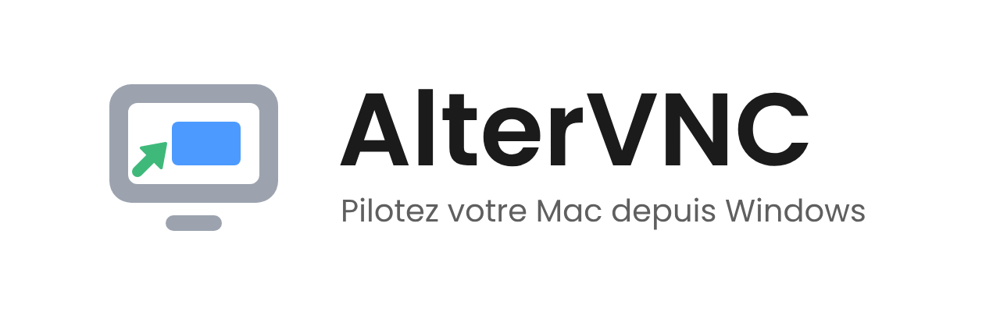
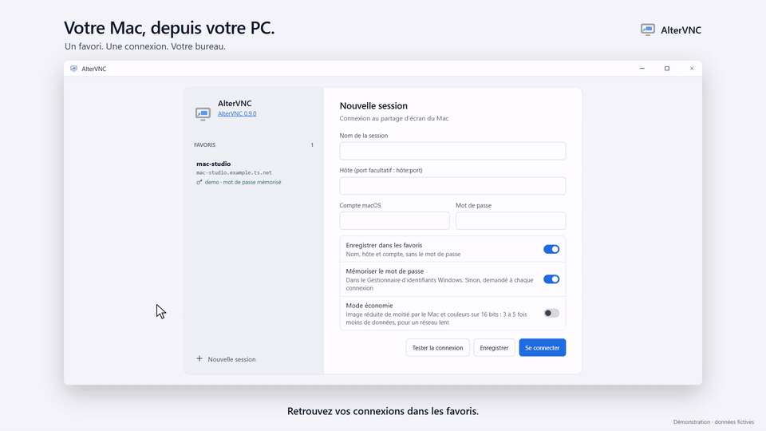
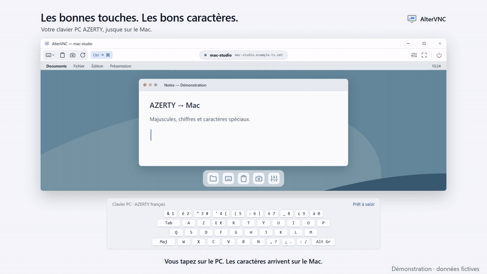
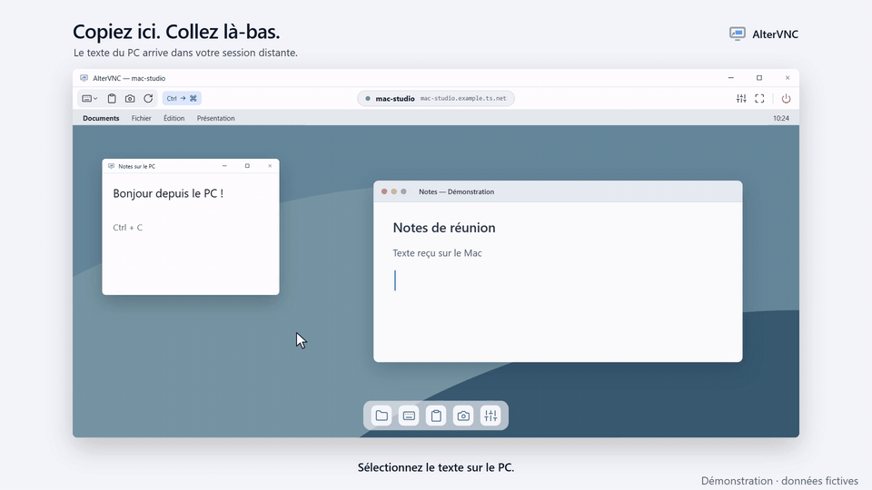
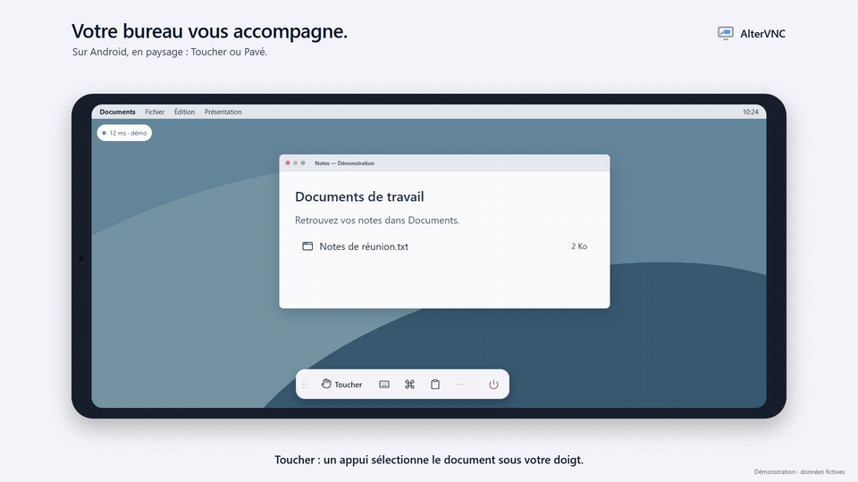
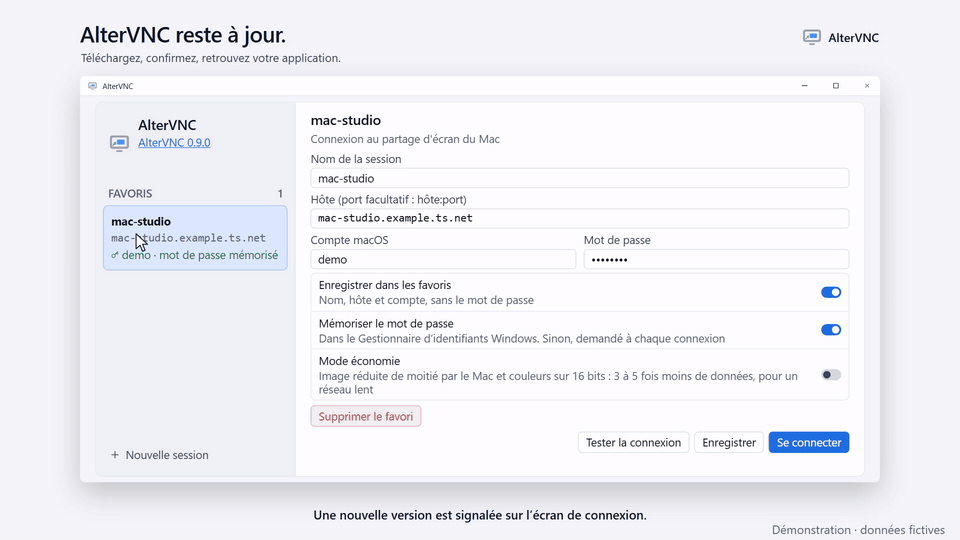

<picture>
  <source media="(prefers-color-scheme: dark)" srcset="readme/altervnc-banniere-sombre.png">
  
</picture>

**Français** · [English](README.md)

Pilotez votre Mac depuis votre PC, avec votre clavier, vos textes et vos connexions favorites à portée de main.

<picture>
  <source media="(prefers-color-scheme: dark)" srcset="videos/01-connect-dark.gif">
  
</picture>

## Télécharger

**[Télécharger la dernière version](https://github.com/syl-craft/AlterVNC-assets/releases/latest)** — Windows x64.

| Paquet | Utilisation |
|---|---|
| **Setup Windows** (`AlterVNC-win-Setup.exe`, ou le fichier versionné `*-Setup.exe`) | Lancez l’installateur, puis ouvrez AlterVNC depuis le menu Démarrer. |
| **Portable** (`*-Portable.zip`) | Extrayez toute l’archive dans un dossier accessible en écriture, puis lancez `AlterVNC.exe`. |

Les deux paquets se trouvent dans la rubrique **Assets** de la release. La version Windows **n’est pas encore signée**.
Si SmartScreen affiche « Windows a protégé votre ordinateur », choisissez
**Informations complémentaires → Exécuter quand même**.

AlterVNC recherche automatiquement les mises à jour. Le lien de version sur l’écran de connexion permet
de consulter les nouveautés, télécharger la mise à jour et confirmer l’installation.
Le téléchargement seul ne redémarre pas l’application.

## Côté Mac

Activez **Partage d’écran** dans **Réglages Système → Général → Partage**, puis autorisez le compte à utiliser.
**Rien à installer sur le Mac** : AlterVNC utilise le serveur de partage d’écran intégré à macOS.
Renseignez dans AlterVNC le nom d’hôte joignable du Mac et un compte autorisé. Un réseau privé comme
Tailscale peut assurer la connexion lorsque les appareils sont sur des réseaux différents.

## Tapez naturellement

Utilisez votre clavier PC AZERTY français et sélectionnez la disposition **Français** sur le Mac distant :
majuscules, chiffres et caractères spéciaux arrivent correctement sur le Mac. La barre de session donne
aussi accès aux touches Mac, et l’option **Ctrl → Cmd** adapte les raccourcis habituels du PC à leurs
équivalents sur Mac.

<picture>
  <source media="(prefers-color-scheme: dark)" srcset="videos/02-keyboard-dark.gif">
  
</picture>

## Copiez sur le PC, collez sur le Mac

Copiez le texte sur le PC, puis cliquez sur **Coller** dans la barre de session, ou utilisez **Ctrl+Maj+V**.
Le texte Latin-1 passe par le presse-papiers distant ; les autres caractères sont envoyés comme des frappes.
Le transfert du presse-papiers du Mac vers le PC n’est pas encore pris en charge.

<picture>
  <source media="(prefers-color-scheme: dark)" srcset="videos/03-clipboard-dark.gif">
  
</picture>

Les favoris conservent l’hôte et le compte. La mémorisation du mot de passe est facultative et utilise
le Gestionnaire d’identifiants Windows. La barre propose capture d’écran, actualisation et plein écran.
Le mode économie réduit la taille de l’image et la profondeur des couleurs pour les connexions lentes.

## Android aussi

En paysage, le bureau distant occupe l’écran et une barre déplaçable garde les commandes à proximité.
**Toucher** agit directement à l’endroit touché ; **Pavé** déplace le pointeur selon le mouvement du doigt.
L’interface Android propose les thèmes clair et sombre. Les mises à jour automatiques desktop ne concernent
pas Android ; consultez les notes de release pour les paquets proposés.

<picture>
  <source media="(prefers-color-scheme: dark)" srcset="videos/04-android-dark.gif">
  
</picture>

## Des mises à jour que vous maîtrisez

La pastille de version signale une nouvelle release. La fenêtre de mise à jour, fournie par **Mue**, présente
les nouveautés et la progression du téléchargement. L’installation est une action distincte : confirmez
le redémarrage, puis retrouvez la nouvelle version avec vos favoris conservés.

<picture>
  <source media="(prefers-color-scheme: dark)" srcset="videos/05-updates-dark.gif">
  
</picture>

### Ligne de commande

`AlterVNC update` utilise le même service sans ouvrir de fenêtre. Sous Windows, appelez
**`current\AlterVNC.exe`**, plutôt que le lanceur à la racine de l’installation, pour récupérer le code
de sortie de l’application. Sous PowerShell, une canalisation attend la fin de cet exécutable fenêtré :

```powershell
# Emplacement par défaut du Setup ; adaptez pour une installation portable.
$exe = Join-Path $env:LOCALAPPDATA 'AlterVNC\current\AlterVNC.exe'
$rapport = & $exe update --check --json | Out-String
$code = $LASTEXITCODE
$rapport | ConvertFrom-Json
$code

# Télécharger et installer en acceptant le résumé de redémarrage.
& $exe update --yes --restart --json | Out-String
```

`--check` vérifie seulement ; `--yes` accepte le résumé de préparation ; `--restart` relance AlterVNC.
Si une fenêtre AlterVNC ou un autre programme bloque l’installation, fermez-le vous-même ou ajoutez
explicitement `--close-blockers`. `--yes` seul n’autorise pas la fermeture de ces programmes.
`--help` décrit les options. Principaux codes : **0** à jour ou installation lancée, **10** version disponible,
**20** bloqué, **21** confirmation requise, **22** indisponible. Le résultat « updated » annonce le lancement
de l’installation, pas la fin du remplacement des fichiers.

---

Les clips sont des démonstrations scénarisées en français, avec des données fictives et un bureau générique.
Versions, durées et tailles téléchargées sont illustratives. Les médias clair/sombre suivent le thème GitHub ;
**l’application Windows actuelle utilise le thème sombre**, tandis qu’Android propose les deux.
[Catalogue des vidéos et MP4 en pleine qualité](videos/README.md).

Ce dépôt est la vitrine publique d’AlterVNC, le lieu de téléchargement des releases et la bibliothèque d’assets.
Le dépôt du code de l’application est privé.

## Brand kit

Logo et kit graphique d'[AlterVNC](https://github.com/syl-craft/AlterVNC), client VNC Windows pour piloter un Mac.
Le lien du code source renvoie au dépôt privé.

| Dossier | Contenu |
|---|---|
| `altervnc-symbole.svg`, `altervnc-symbole-small.svg` | Sources du symbole : master et version 16 à 24 px |
| `logo/` | Icône `.ico`, PNG, SVG, lockups — règles d'usage dans `logo/README.md` |
| `readme/` | Bannières, aperçu social, logo animé pour un README |
| `video/` | Cartes titre, intros, symbole animé sur fond transparent, calques |
| `concepts/`, `couleurs/` | Planches de travail : trois concepts en noir, variantes de couleur, passage du trait à la flèche |

Le kit est généré par le skill `logo-application` (`build_all.py`) à partir des deux SVG sources.
