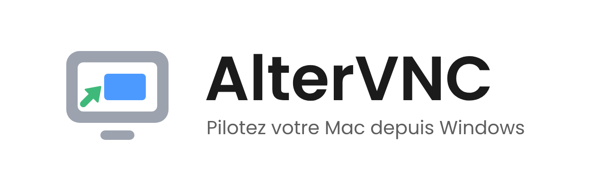

<picture>
  <source media="(prefers-color-scheme: dark)" srcset="readme/altervnc-banniere-sombre.png">
  
</picture>

[Français](README.fr.md) · **English**

Control your Mac from your PC, with your keyboard, your text and your favourite connections close at hand.

<picture>
  <source media="(prefers-color-scheme: dark)" srcset="https://raw.githubusercontent.com/syl-craft/AlterVNC-assets/main/videos/01-connect-dark.gif">
  
</picture>

## Download

**[Get the latest release](https://github.com/syl-craft/AlterVNC-assets/releases/latest)** — Windows x64.

| Package | How to use it |
|---|---|
| **Windows Setup** (`AlterVNC-win-Setup.exe`, or the versioned `*-Setup.exe`) | Run the installer, then open AlterVNC from the Start menu. |
| **Portable** (`*-Portable.zip`) | Extract the entire archive to a writable folder, then launch `AlterVNC.exe`. |

Both packages are available in the release’s **Assets** section. The Windows build is **not yet code-signed**.
If SmartScreen shows “Windows protected your PC”, choose **More info → Run anyway**
(French Windows: **Informations complémentaires → Exécuter quand même**).

AlterVNC checks for updates automatically. Open the version link on the connection screen to review
what is new, download the update and confirm installation. Downloading alone does not restart the app.

## On your Mac

Enable **Screen Sharing** in **System Settings → General → Sharing**, and allow the account you will use.
**Nothing to install on the Mac**: AlterVNC connects to the screen-sharing server already built into macOS.
Enter the Mac’s reachable hostname and an authorised account in AlterVNC. A private network such as
Tailscale can provide that connection when the devices are on different networks.

## Type naturally

Use a French AZERTY PC keyboard: uppercase letters, digits and special characters arrive correctly on
the Mac. The session toolbar also provides special Mac keys, and the **Ctrl → Cmd** option maps familiar
PC shortcuts to their Mac equivalents.

<picture>
  <source media="(prefers-color-scheme: dark)" srcset="https://raw.githubusercontent.com/syl-craft/AlterVNC-assets/main/videos/02-keyboard-dark.gif">
  
</picture>

## Copy on the PC, paste on the Mac

Copy text on your PC, then click **Paste** in the session toolbar, or press **Ctrl+Shift+V**.
Latin-1 text goes through the remote clipboard; other characters are sent as keystrokes.
Clipboard transfer from the Mac back to the PC is not supported yet.

<picture>
  <source media="(prefers-color-scheme: dark)" srcset="https://raw.githubusercontent.com/syl-craft/AlterVNC-assets/main/videos/03-clipboard-dark.gif">
  
</picture>

Favourites remember the host and account. Password storage is optional and uses Windows Credential Manager.
The toolbar offers screenshots, refresh and full screen. Economy mode reduces image size and colour depth
for slower connections.

## Android, too

In landscape, the remote desktop fills the screen and a movable toolbar keeps the controls nearby.
**Touch** acts directly where you tap; **Trackpad** moves the pointer relative to your finger.
The Android interface supports both light and dark themes. Desktop automatic updates do not apply to Android;
refer to the release notes for the packages provided.

<picture>
  <source media="(prefers-color-scheme: dark)" srcset="https://raw.githubusercontent.com/syl-craft/AlterVNC-assets/main/videos/04-android-dark.gif">
  
</picture>

## Updates, with you in control

The version badge points to a new release. The update window, powered by **Mue**, shows release notes
and download progress. Installation is a separate action: confirm the restart, then return to the new version
with your favourites preserved.

<picture>
  <source media="(prefers-color-scheme: dark)" srcset="https://raw.githubusercontent.com/syl-craft/AlterVNC-assets/main/videos/05-updates-dark.gif">
  
</picture>

### Command line

`AlterVNC update` uses the same update service without opening a window. On Windows, call
**`current\AlterVNC.exe`**, rather than the launcher at the installation root, to obtain the application’s
exit code. In PowerShell, pipe the output to wait for this windowed executable:

```powershell
# Default Setup location; adapt this path for a portable installation.
$exe = Join-Path $env:LOCALAPPDATA 'AlterVNC\current\AlterVNC.exe'
$report = & $exe update --check --json | Out-String
$code = $LASTEXITCODE
$report | ConvertFrom-Json
$code

# Download and install after accepting the restart summary.
& $exe update --yes --restart --json | Out-String
```

`--check` only checks; `--yes` accepts the preparation summary; `--restart` reopens AlterVNC afterward.
If an open AlterVNC window or another program blocks installation, close it yourself or explicitly use
`--close-blockers`. `--yes` alone does not authorise closing those programs.
`--help` lists the options. Key exit codes: **0** up to date or installation launched, **10** update available,
**20** blocked, **21** confirmation required, **22** unavailable. An “updated” result means installation
has started; it does not prove the file replacement has finished.

---

The clips are scripted demonstrations in French, using fictional data and a generic remote desktop.
Versions, timings and download sizes are illustrative. Light/dark media follow your GitHub theme;
**the current Windows app uses the dark theme**, while Android offers both.
[Video catalogue and full-quality MP4 files](videos/README.md).

This repository is AlterVNC’s public showcase, release-download location and asset library.
The application source repository is private.

## Brand kit

Logo and visual identity kit for [AlterVNC](https://github.com/syl-craft/AlterVNC) (private source repository),
the Windows VNC client for controlling a Mac.

| Folder | Contents |
|---|---|
| `altervnc-symbole.svg`, `altervnc-symbole-small.svg` | Symbol sources: master and 16–24 px variant |
| `logo/` | `.ico`, PNG, SVG and lockups — usage guidelines in [`logo/README.md`](logo/README.md) |
| `readme/` | Banners, social preview and animated README logo |
| `video/` | Title cards, intros, animated symbol on transparent background and layers |
| `concepts/`, `couleurs/` | Working boards: three concepts in black, colour variants, stroke-to-arrow evolution |

The kit is generated by the `logo-application` skill (`build_all.py`) from the two source SVG files.
